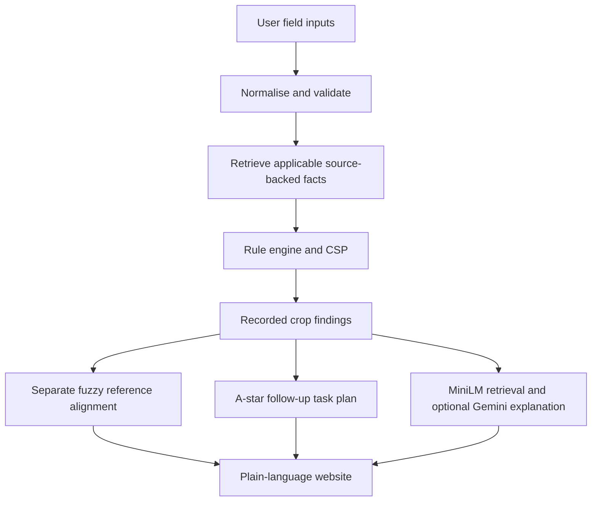

# Fuzzy alignment and A* follow-up planning

These implementation notes support code review and viva preparation. The final academic report is deferred until the template arrives.

## What each technique does

CSP still determines the crop's recorded status using season, water, soil and pH. Fuzzy logic describes gradual alignment of supported numeric measurements. A* plans a sequence of information-gathering and evidence-review tasks. Neither new module changes a profile, inserts knowledge, guarantees suitability or executes a real-world action.

### Fuzzy logic: zero-order Sugeno

`fuzzy_logic.py` uses two numeric inputs from eligible, reviewed, applicable facts:

- pH distance = distance outside the documented range / max(range width, 1).
- Water ratio = the entered budget / the upper water-reference value, on the same basis.

Season and soil checks must already be satisfied. A known violation blocks the index. Missing, conflicting, unreviewed or mismatched numeric references cannot receive a score. An unresolved pH/water comparison can have a separate index, visibly retaining its review status.

Membership sets and engineering settings:

| Input | Set | Membership shape |
|---|---|---|
| pH distance | aligned | 1 at 0, falling to 0 at 0.25 |
| pH distance | nearby | triangle (0, 0.25, 0.75) |
| pH distance | distant | rises from 0 at 0.25 to 1 at 0.75 |
| Water ratio | low | 1 up to 0.5, falling to 0 at 0.8 |
| Water ratio | partial | triangle (0.5, 0.8, 1.0) |
| Water ratio | covered | rises from 0 at 0.8 to 1 at 1.0 |

These breakpoints and output constants are configurable engineering assumptions, not sourced crop-growth thresholds or expert-calibrated agricultural advice. They operate on normalised comparisons after sourcing the underlying ranges.

| pH / water | Low | Partial | Covered |
|---|---|---|---|
| Aligned | Limited: 20 | Moderate: 55 | Close: 85 |
| Nearby | Limited: 20 | Limited: 20 | Moderate: 55 |
| Distant | Limited: 20 | Limited: 20 | Limited: 20 |

AND is `min(ph_membership, water_membership)`. Each rule produces a constant output. The final index is `sum(strength * consequent) / sum(strength)`. This is zero-order Sugeno inference, not Mamdani centroid defuzzification. Rule strengths and memberships are retained in the trace. Index points are not probabilities; no trained accuracy or calibrated crop-success score is claimed.

Method background: [MathWorks documentation on Sugeno systems](https://www.mathworks.com/help/fuzzy/types-of-fuzzy-inference-systems.html).

### A*: an actual state-space search

`astar_search.py` contains the reusable search. `preparation_planner.py` defines this project's actions and goal.

| Search element | Implementation |
|---|---|
| State | Frozenset of currently covered follow-up requirement IDs. |
| Initial state | Empty set: no planned follow-up tasks have been covered yet. |
| Goal | All follow-up needs identified by the current saved assessment are covered by the plan. |
| Actions | Obtain measurements, gather pH and texture results together, review a condition, or combine evidence reviews. |
| Preconditions | Relevant measurement tasks precede evidence-review tasks when those inputs are missing. |
| Transition | Add the requirements covered by an applicable action. |
| Step cost | Positive relative effort points from the declared task model. |
| Path cost g | Sum of action effort points so far. |
| Heuristic h | Maximum, over unmet requirements, of the cheapest action covering that requirement. |
| Priority f | g + h; implemented with a heap priority queue. |

Why that heuristic is admissible: every unmet requirement needs at least one covering action. Its cheapest covering action is a lower bound on the total remaining cost. Taking the maximum retains a lower bound, whereas summing can double-count an action covering several requirements. Ignoring prerequisites is optimistic. The same bound is consistent: an action either leaves a requirement unmet or covers it at a cost at least as large as its cheapest covering cost.

The implementation keeps the best known g per state, skips stale queue entries, checks the goal when popped, and reconstructs the chosen sequence through parent links. A limit of 4,096 expansions prevents runaway work. A limit or unreachable goal is reported as a failure to complete a plan, not as an optimal answer.

The goal means covering the currently identified information tasks. It does NOT mean the measurements will be favorable, evidence will be found, or the crop will become feasible. A new assessment with real observations is required afterward, and further questions may appear. Effort points are not hours, money or measured local costs. Optimality is only within these declared actions/costs and requires search completion.

Example: with season, pH, soil texture and water missing, separate tasks total 8 points. Gathering the two soil results together costs 4 instead of 3+2, so A* returns a three-step plan totaling 7. Uniform-cost search returns the same minimum cost. This is not a physical farm-treatment plan.

Search background: [CMU search notes](https://www.cs.cmu.edu/~07280-f26/notes/search/index.html). The Snake example uses a different state space; its grid heuristic and experimental scores are not transplanted into this project.

## Website and AI/non-AI separation

After a new assessment, crop findings are followed by **How closely do pH and water align?** and **A practical order for following up**. Public pages use everyday wording; internal JSON includes membership strengths, fired rules, action costs, initial/goal states and g/h/f traces for inspection.

AI methods: rule inference, CSP search, fuzzy inference, A* planning, MiniLM semantic retrieval and Gemini generation. Non-AI infrastructure: HTML/CSS, form parsing, validation, HTTP routing, SQLite snapshots, link expiry, caching, and deterministic PDF formatting. Validation supports AI reliability but is not itself a learned prediction algorithm.



## Verify and show the implementation

```sh
python3 -m pytest -q
python3 scripts/check_fuzzy_search.py
python3 app.py
```

For fuzzy behavior, use Haryana, Rabi, Wheat, loamy soil, pH 7 and 600 mm seasonal water. The crop remains unresolved on local water demand, while the numeric index shows graded alignment. Change water to 300 mm: the known violation blocks the index.

For a nontrivial A* sequence, use the wheat example with unknown season and texture and blank pH/water. Open the planned steps and inspect the `preparation_plan` JSON or the two planner modules. No extra model, training data, API key or Python package is required for these two additions.

Automated checks cover fuzzy boundaries, weighted inference, source eligibility, non-mutation, hard-check preservation, A* versus uniform-cost optimal costs, heuristic admissibility/consistency, prerequisites, unreachable goals and expansion limits. `fuzzy_search_checks.json` records 32 controlled scenario comparisons. It is not an agricultural accuracy benchmark.
